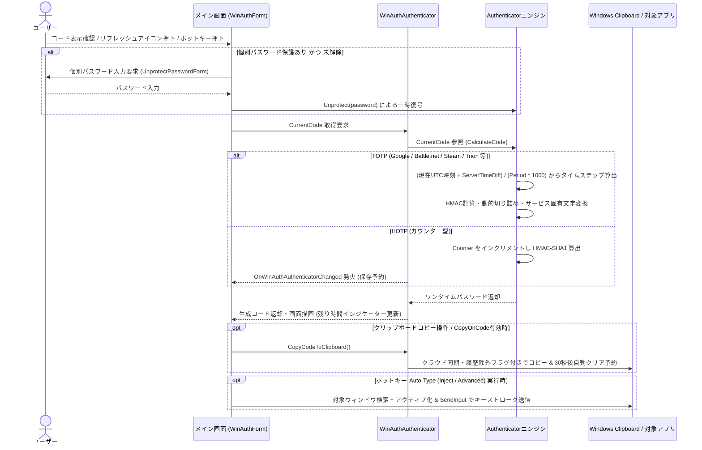
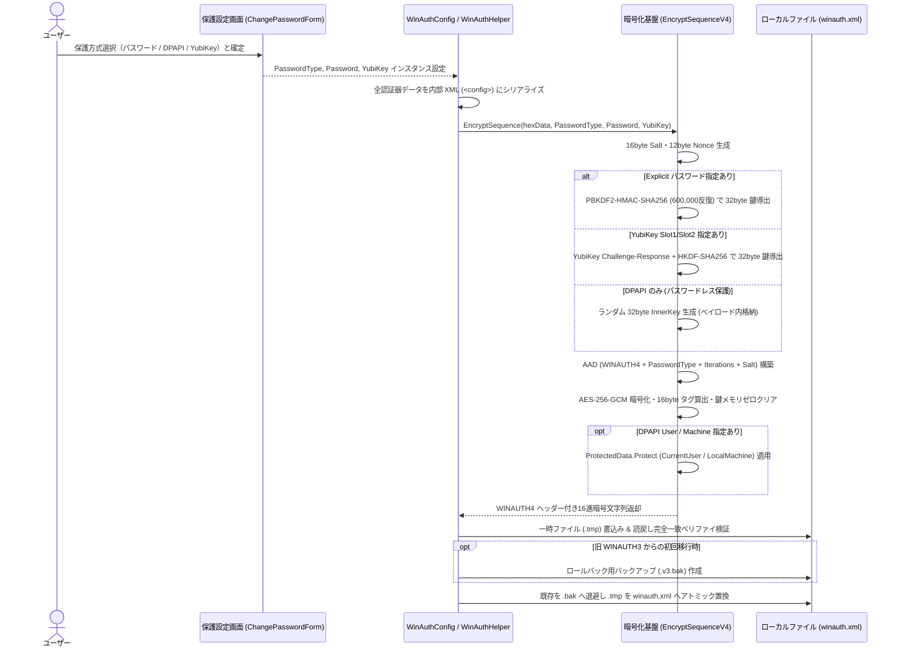
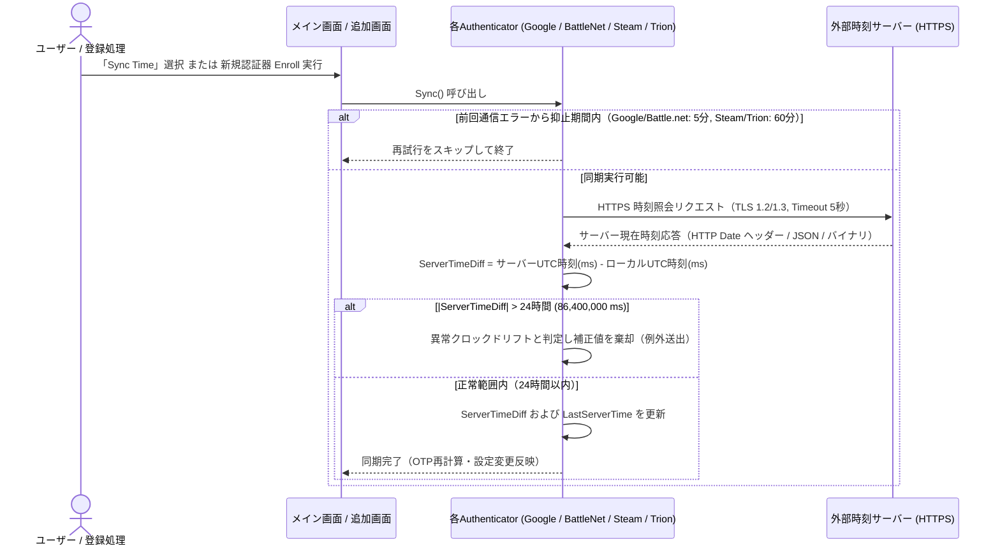
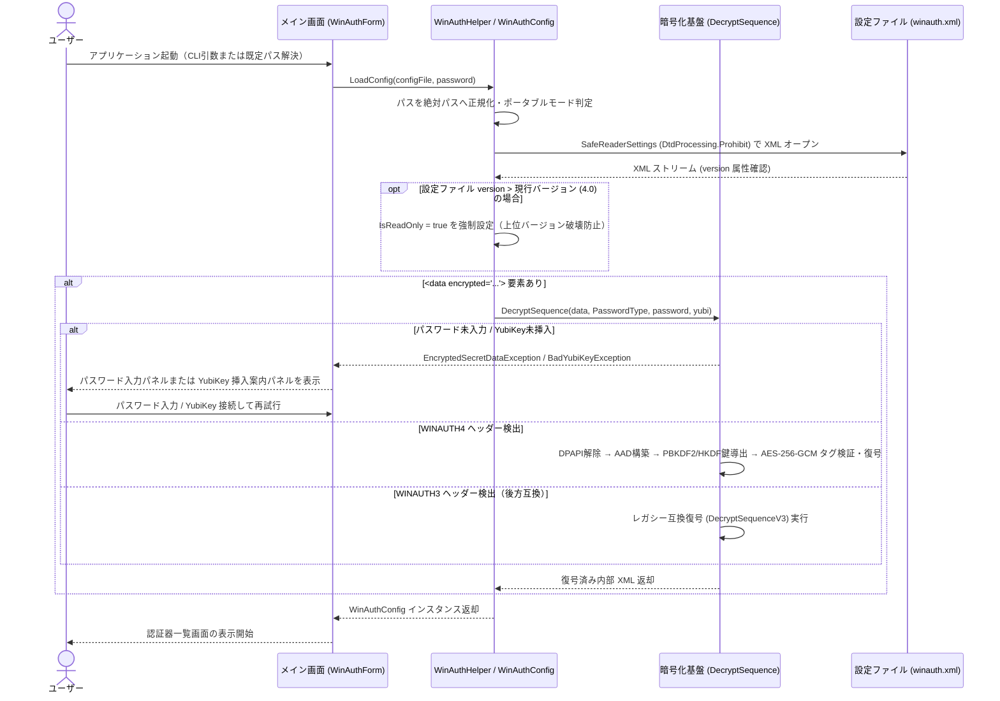
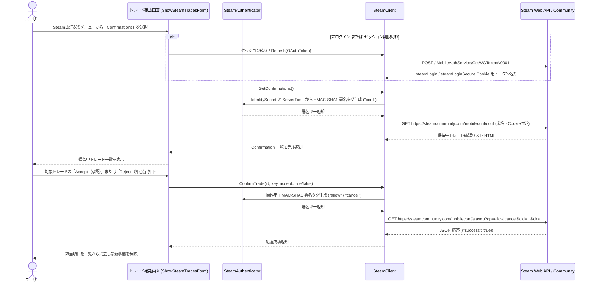
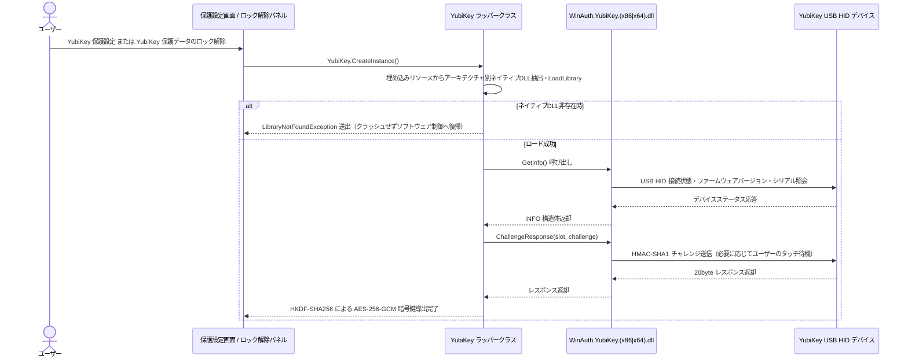

# 業務フロー

WinAuth における主要な業務（利用・保護・外部連携）の処理フローを以下に定義します。

## 1. ワンタイムパスワード（TOTP / HOTP）生成・利用フロー（BR-001, BR-002, BR-007）

登録済みの認証器から時間型（TOTP）またはカウンター型（HOTP）のワンタイムパスワードを算出し、画面表示・クリップボード保護コピーまたはホットキー自動入力を行う基本フローです。

---

## 2. WINAUTH4 多層暗号化による設定保護・アトミック保存フロー（BR-003, BR-008）

マスターパスワード、Windows DPAPI、YubiKey を組み合わせ、`WINAUTH4`（PBKDF2-SHA256 600,000反復 + AES-256-GCM）形式で保護して `winauth.xml` へ安全に永続化するフローです。

---

## 3. 外部タイムサーバーとの時刻同期・ドリフト検証フロー（BR-005）

外部サーバーと HTTPS 通信を行って `ServerTimeDiff` を算出し、24時間を超える異常ドリフトを遮断するフローです。

---

## 4. 起動時ファイル検証・復号・互換読み込みフロー（BR-003, BR-008, BR-009）

アプリケーション起動時に `SafeReaderSettings`（XXE防止）で設定ファイルを読み込み、上位バージョン保護判定および `WINAUTH4` / `WINAUTH3` 復号を行うフローです。

---

## 5. Steam モバイルトレード確認・承認・拒否フロー（BR-006）

Steam モバイル認証セッションを確立し、保留中のトレードやマーケット出品の確認・承認・拒否を行うフローです。

---

## 6. YubiKey ハードウェアトークン連携フロー（BR-004）

USB HID 経由で YubiKey を検出し、チャレンジ・レスポンスによって暗号鍵を導出するフローです。

