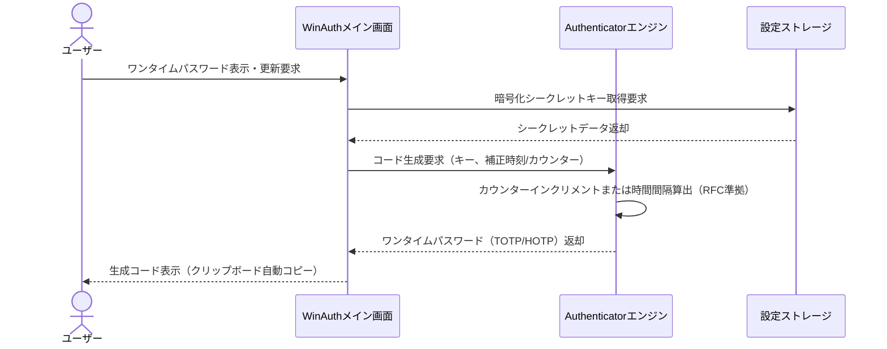
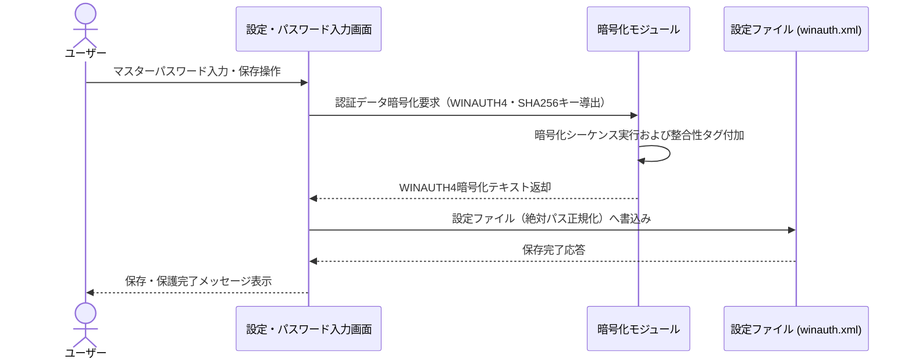
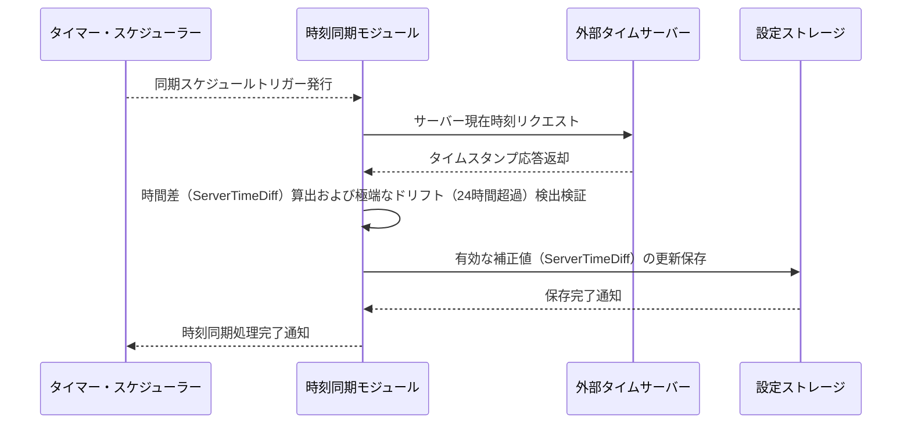
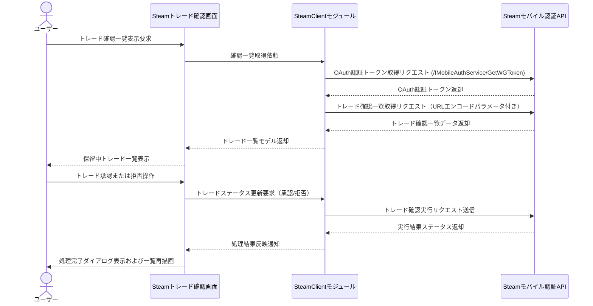
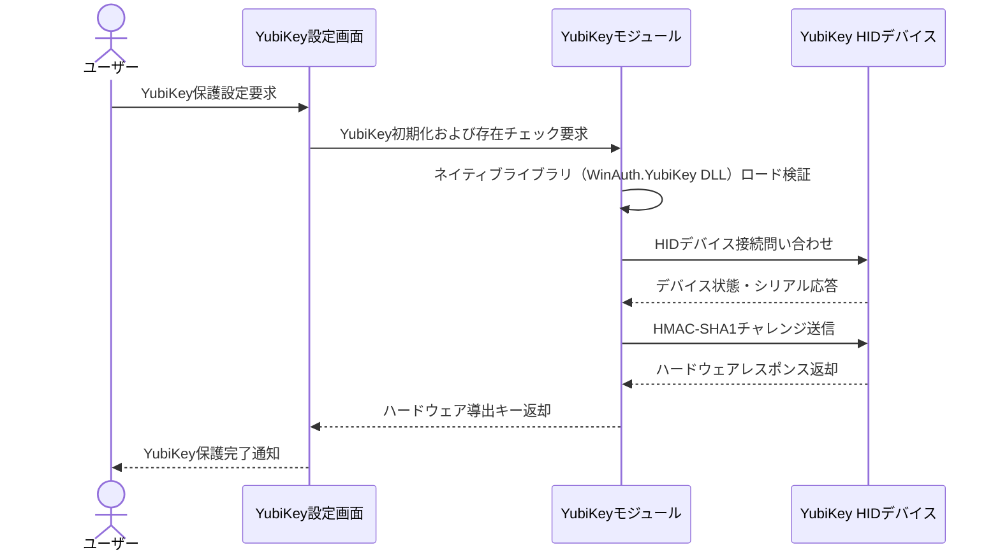
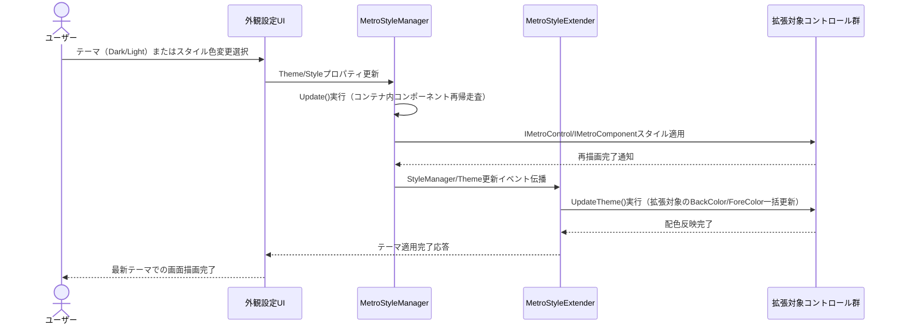

# 業務フロー

## 認証管理

シークレットキーとサーバー同期時刻またはカウンター値に基づく時間型/カウンター型ワンタイムパスワード（TOTP/HOTP）生成処理フロー

**参加者:** ユーザー (actor)、WinAuthメイン画面 (system)、Authenticatorエンジン (system)、設定ストレージ (database)

**メッセージフロー:**
- ユーザー → WinAuthメイン画面: ワンタイムパスワード表示・更新要求
- WinAuthメイン画面 → 設定ストレージ: 暗号化シークレットキー取得要求
  - 設定ストレージ ← WinAuthメイン画面: シークレットデータ返却
- WinAuthメイン画面 → Authenticatorエンジン: コード生成要求（キー、補正時刻/カウンター）
- Authenticatorエンジン → Authenticatorエンジン: カウンターインクリメントまたは時間間隔算出（RFC準拠）
  - Authenticatorエンジン ← WinAuthメイン画面: ワンタイムパスワード（TOTP/HOTP）返却
  - WinAuthメイン画面 ← ユーザー: 生成コード表示（クリップボード自動コピー）

## セキュリティ管理

マスターパスワードを使用したWINAUTH4形式による認証情報の暗号化保管および改ざん検知付き復号処理フロー

**参加者:** ユーザー (actor)、設定・パスワード入力画面 (system)、暗号化モジュール (system)、設定ファイル (winauth.xml) (database)

**メッセージフロー:**
- ユーザー → 設定・パスワード入力画面: マスターパスワード入力・保存操作
- 設定・パスワード入力画面 → 暗号化モジュール: 認証データ暗号化要求（WINAUTH4・SHA256キー導出）
- 暗号化モジュール → 暗号化モジュール: 暗号化シーケンス実行および整合性タグ付加
  - 暗号化モジュール ← 設定・パスワード入力画面: WINAUTH4暗号化テキスト返却
- 設定・パスワード入力画面 → 設定ファイル (winauth.xml): 設定ファイル（絶対パス正規化）へ書込み
  - 設定ファイル (winauth.xml) ← 設定・パスワード入力画面: 保存完了応答
  - 設定・パスワード入力画面 ← ユーザー: 保存・保護完了メッセージ表示

## 時刻同期

外部タイムサーバーとの通信による端末時間差（時間ドリフト）の取得および24時間超過検証・補正フロー

**参加者:** タイマー・スケジューラー (system)、時刻同期モジュール (system)、外部タイムサーバー (external)、設定ストレージ (database)

**メッセージフロー:**
- タイマー・スケジューラー → 時刻同期モジュール: 同期スケジュールトリガー発行
- 時刻同期モジュール → 外部タイムサーバー: サーバー現在時刻リクエスト
  - 外部タイムサーバー ← 時刻同期モジュール: タイムスタンプ応答返却
- 時刻同期モジュール → 時刻同期モジュール: 時間差（ServerTimeDiff）算出および極端なドリフト（24時間超過）検出検証
- 時刻同期モジュール → 設定ストレージ: 有効な補正値（ServerTimeDiff）の更新保存
  - 設定ストレージ ← 時刻同期モジュール: 保存完了通知
  - 時刻同期モジュール ← タイマー・スケジューラー: 時刻同期処理完了通知

## トレード管理

Steamモバイル認証APIと連携したトレード確認一覧の安全な取得および承認・拒否実行フロー

**参加者:** ユーザー (actor)、Steamトレード確認画面 (system)、SteamClientモジュール (system)、Steamモバイル認証API (external)

**メッセージフロー:**
- ユーザー → Steamトレード確認画面: トレード確認一覧表示要求
- Steamトレード確認画面 → SteamClientモジュール: 確認一覧取得依頼
- SteamClientモジュール → Steamモバイル認証API: OAuth認証トークン取得リクエスト (/IMobileAuthService/GetWGToken)
  - Steamモバイル認証API ← SteamClientモジュール: OAuth認証トークン返却
- SteamClientモジュール → Steamモバイル認証API: トレード確認一覧取得リクエスト（URLエンコードパラメータ付き）
  - Steamモバイル認証API ← SteamClientモジュール: トレード確認一覧データ返却
  - SteamClientモジュール ← Steamトレード確認画面: トレード一覧モデル返却
  - Steamトレード確認画面 ← ユーザー: 保留中トレード一覧表示
- ユーザー → Steamトレード確認画面: トレード承認または拒否操作
- Steamトレード確認画面 → SteamClientモジュール: トレードステータス更新要求（承認/拒否）
- SteamClientモジュール → Steamモバイル認証API: トレード確認実行リクエスト送信
  - Steamモバイル認証API ← SteamClientモジュール: 実行結果ステータス返却
  - SteamClientモジュール ← Steamトレード確認画面: 処理結果反映通知
  - Steamトレード確認画面 ← ユーザー: 処理完了ダイアログ表示および一覧再描画

## ハードウェア連携

USB接続されたYubiKeyハードウェアデバイスの安全な検出および暗号化シード保護フロー

**参加者:** ユーザー (actor)、YubiKey設定画面 (system)、YubiKeyモジュール (system)、YubiKey HIDデバイス (external)

**メッセージフロー:**
- ユーザー → YubiKey設定画面: YubiKey保護設定要求
- YubiKey設定画面 → YubiKeyモジュール: YubiKey初期化および存在チェック要求
- YubiKeyモジュール → YubiKeyモジュール: ネイティブライブラリ（WinAuth.YubiKey DLL）ロード検証
- YubiKeyモジュール → YubiKey HIDデバイス: HIDデバイス接続問い合わせ
  - YubiKey HIDデバイス ← YubiKeyモジュール: デバイス状態・シリアル応答
- YubiKeyモジュール → YubiKey HIDデバイス: HMAC-SHA1チャレンジ送信
  - YubiKey HIDデバイス ← YubiKeyモジュール: ハードウェアレスポンス返却
  - YubiKeyモジュール ← YubiKey設定画面: ハードウェア導出キー返却
  - YubiKey設定画面 ← ユーザー: YubiKey保護完了通知

## 画面デザイン管理

MetroStyleManagerとMetroStyleExtenderによるUIコントロールへのテーマ・スタイル一括適用フロー

**参加者:** ユーザー (actor)、外観設定UI (system)、MetroStyleManager (system)、MetroStyleExtender (system)、拡張対象コントロール群 (system)

**メッセージフロー:**
- ユーザー → 外観設定UI: テーマ（Dark/Light）またはスタイル色変更選択
- 外観設定UI → MetroStyleManager: Theme/Styleプロパティ更新
- MetroStyleManager → MetroStyleManager: Update()実行（コンテナ内コンポーネント再帰走査）
- MetroStyleManager → 拡張対象コントロール群: IMetroControl/IMetroComponentスタイル適用
  - 拡張対象コントロール群 ← MetroStyleManager: 再描画完了通知
- MetroStyleManager → MetroStyleExtender: StyleManager/Theme更新イベント伝播
- MetroStyleExtender → 拡張対象コントロール群: UpdateTheme()実行（拡張対象のBackColor/ForeColor一括更新）
  - 拡張対象コントロール群 ← MetroStyleExtender: 配色反映完了
  - MetroStyleExtender ← 外観設定UI: テーマ適用完了応答
  - 外観設定UI ← ユーザー: 最新テーマでの画面描画完了

