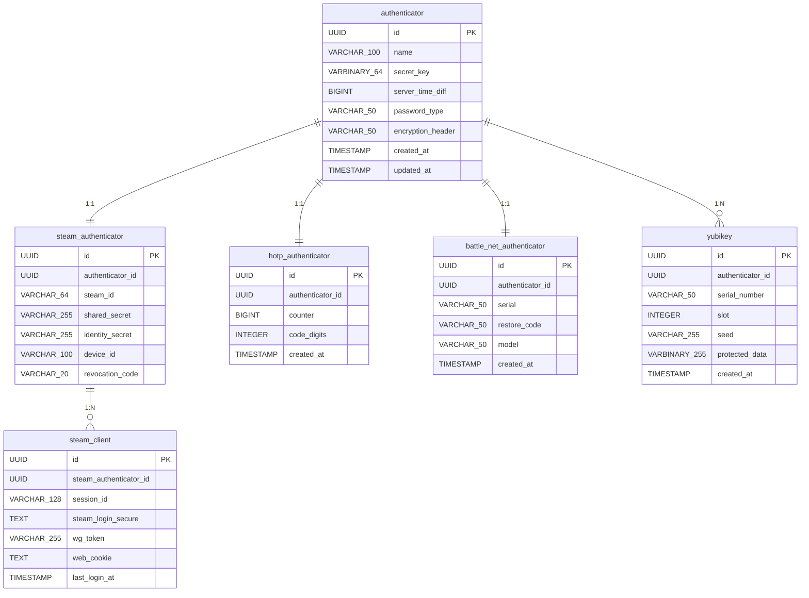

# ER図

WinAuthアプリケーションの二要素認証設定・トークン保持構造を表すER図。基底となるAuthenticatorエンティティを中心に、Steam、Battle.net、HOTP等のプロバイダ固有の派生モデル、YubiKeyハードウェアトークン保護情報、およびSteamのトレード確認用セッションクライアント（SteamClient）とのリレーションシップをモデル化しています。

### エンティティ一覧

**AUTHENTICATOR**

| カラム名 | データ型 | キー |
| --- | --- | --- |
| id | UUID | PK |
| name | VARCHAR(100) |  |
| secret_key | VARBINARY(64) |  |
| server_time_diff | BIGINT |  |
| password_type | VARCHAR(50) |  |
| encryption_header | VARCHAR(50) |  |
| created_at | TIMESTAMP |  |
| updated_at | TIMESTAMP |  |

**STEAM_AUTHENTICATOR**

| カラム名 | データ型 | キー |
| --- | --- | --- |
| id | UUID | PK |
| authenticator_id | UUID |  |
| steam_id | VARCHAR(64) |  |
| shared_secret | VARCHAR(255) |  |
| identity_secret | VARCHAR(255) |  |
| device_id | VARCHAR(100) |  |
| revocation_code | VARCHAR(20) |  |

**HOTP_AUTHENTICATOR**

| カラム名 | データ型 | キー |
| --- | --- | --- |
| id | UUID | PK |
| authenticator_id | UUID |  |
| counter | BIGINT |  |
| code_digits | INTEGER |  |
| created_at | TIMESTAMP |  |

**BATTLE_NET_AUTHENTICATOR**

| カラム名 | データ型 | キー |
| --- | --- | --- |
| id | UUID | PK |
| authenticator_id | UUID |  |
| serial | VARCHAR(50) |  |
| restore_code | VARCHAR(50) |  |
| model | VARCHAR(50) |  |
| created_at | TIMESTAMP |  |

**YUBIKEY**

| カラム名 | データ型 | キー |
| --- | --- | --- |
| id | UUID | PK |
| authenticator_id | UUID |  |
| serial_number | VARCHAR(50) |  |
| slot | INTEGER |  |
| seed | VARCHAR(255) |  |
| protected_data | VARBINARY(255) |  |
| created_at | TIMESTAMP |  |

**STEAM_CLIENT**

| カラム名 | データ型 | キー |
| --- | --- | --- |
| id | UUID | PK |
| steam_authenticator_id | UUID |  |
| session_id | VARCHAR(128) |  |
| steam_login_secure | TEXT |  |
| wg_token | VARCHAR(255) |  |
| web_cookie | TEXT |  |
| last_login_at | TIMESTAMP |  |

### リレーション

- AUTHENTICATOR → STEAM_AUTHENTICATOR (1:1)
- AUTHENTICATOR → HOTP_AUTHENTICATOR (1:1)
- AUTHENTICATOR → BATTLE_NET_AUTHENTICATOR (1:1)
- AUTHENTICATOR → YUBIKEY (1:N)
- STEAM_AUTHENTICATOR → STEAM_CLIENT (1:N)

### ER図

