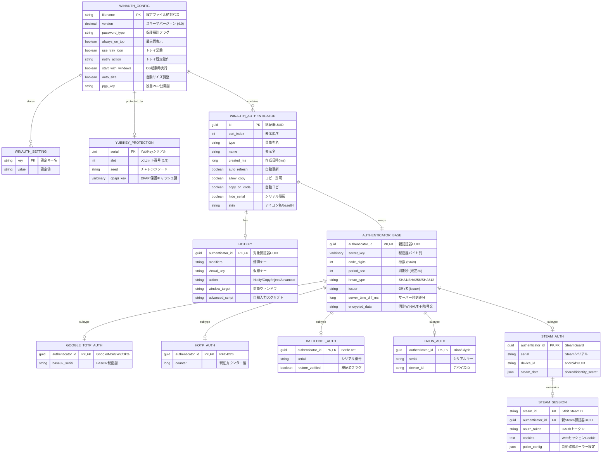

# ER図

WinAuth の永続化データ構造（`winauth.xml`）およびメモリ上のドメインオブジェクト間の関連（エンティティ・リレーションシップ）を以下に定義します。

## 1. エンティティ構成と責務

| エンティティ名 | 対応クラス | 主キー / 識別子 | 概要 |
| --- | --- | --- | --- |
| `WINAUTH_CONFIG` | `WinAuthConfig` | `filename` | 設定全体と認証器リストを保持するルート集約。保護有効時は `<data>` 暗号化コンテナを管理する。 |
| `WINAUTH_SETTING` | `WinAuthConfig.setting` | `key` | ポータブルモード時の `<settings>` 要素（または通常モード時のレジストリ値）の Key-Value ペア。 |
| `YUBIKEY_PROTECTION` | `YubiKey` / `YubikeyData` | `serial` | YubiKey 保護時に使用するデバイス情報および DPAPI 保護された導出鍵キャッシュ。 |
| `WINAUTH_AUTHENTICATOR` | `WinAuthAuthenticator` | `id` (GUID) | UI 表示属性（名前、作成日時、スキン、自動更新・コピー設定）と認証エンジン本体を結ぶラッパー。 |
| `HOTKEY` | `HotKey` | `authenticator_id` | 認証器に 0..1 で設定されるグローバルホットキーおよび自動キー入力定義。 |
| `AUTHENTICATOR_BASE` | `Authenticator` (abstract) | `authenticator_id` | 秘密鍵、周期、桁数、HMAC種別、時刻差分（`ServerTimeDiff`）、個別暗号化データを保持する基底クラス。 |
| `GOOGLE_TOTP_AUTH` | `GoogleAuthenticator` (+ `Microsoft` / `GuildWars` / `OktaVerify`) | `authenticator_id` | 標準 RFC 6238 TOTP プロファイル（派生3クラスも同一データ構造を継承）。 |
| `HOTP_AUTH` | `HOTPAuthenticator` | `authenticator_id` | RFC 4226 カウンター型プロファイル。算出ごとにインクリメントされる `Counter` を保持。 |
| `BATTLENET_AUTH` | `BattleNetAuthenticator` | `authenticator_id` | Blizzard 固有の `Serial`（リージョン識別含む）および 10文字 `RestoreCode` 算出機構を持つ。 |
| `TRION_AUTH` | `TrionAuthenticator` | `authenticator_id` | Trion / Glyph 固有の `Serial` および `DeviceId` を保持。 |
| `STEAM_AUTH` | `SteamAuthenticator` | `authenticator_id` | Steam Guard 固有の `Serial`, `DeviceId`, `SteamData`（`shared_secret`, `identity_secret` 等）を保持。 |
| `STEAM_SESSION` | `SteamClient` / `SteamSession` | `steam_id` | トレード確認用の Web セッション（`OAuthToken`, `Cookies`, 自動ポーラー `ConfirmationPoller`）。 |

---

## 2. リレーションシップ一覧

- `WINAUTH_CONFIG` **1 ── 0..N** `WINAUTH_AUTHENTICATOR` : 順序付き（`Index`）で複数の認証器を保持
- `WINAUTH_CONFIG` **1 ── 0..N** `WINAUTH_SETTING` : ポータブル環境設定を保持
- `WINAUTH_CONFIG` **1 ── 0..1** `YUBIKEY_PROTECTION` : YubiKey ハードウェア保護時に参照
- `WINAUTH_AUTHENTICATOR` **1 ── 0..1** `HOTKEY` : グローバルショートカットキーを保持
- `WINAUTH_AUTHENTICATOR` **1 ── 1** `AUTHENTICATOR_BASE` : 認証アルゴリズム本体を内包
- `AUTHENTICATOR_BASE` **1 ── 0..1** 各派生認証エンティティ : 排他的サブタイプ（継承関係）
- `STEAM_AUTH` **1 ── 0..1** `STEAM_SESSION` : Steam Web セッション・確認ポーラーを保持

---

## 3. ER図（Mermaid）

