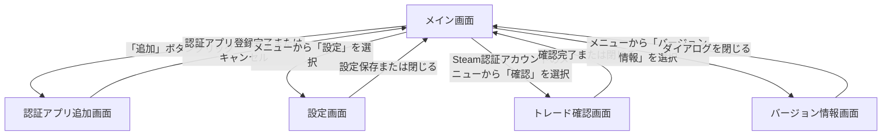

# 画面遷移

WinAuthアプリケーションの画面遷移図です。メイン画面をハブとして、認証アプリの追加、設定変更、Steamトレード確認、バージョン情報表示の各ダイアログおよびサブ画面へ遷移し、操作完了またはキャンセルによりメイン画面へ復帰する導線構成となっています。

**フロー:**
- メイン画面 → 認証アプリ追加画面 (「追加」ボタンクリック)
- 認証アプリ追加画面 → メイン画面 (認証アプリ登録完了またはキャンセル)
- メイン画面 → 設定画面 (メニューから「設定」を選択)
- 設定画面 → メイン画面 (設定保存または閉じる)
- メイン画面 → トレード確認画面 (Steam認証アカウントのメニューから「確認」を選択)
- トレード確認画面 → メイン画面 (確認完了または閉じる)
- メイン画面 → バージョン情報画面 (メニューから「バージョン情報」を選択)
- バージョン情報画面 → メイン画面 (ダイアログを閉じる)

