# 画面遷移

WinAuth アプリケーションにおける全画面・ダイアログ間の遷移構造を以下に定義します。

## 1. 画面遷移設計の特徴
1. **ハブ＆スポーク構成**: メイン画面（`SCR-001: WinAuthForm`）を中心ハブとし、下部の「Add」メニュー、歯車「Options」メニュー、各認証器項目の右クリック「コンテキストメニュー」、およびシステムトレイアイコンから各モーダルダイアログへ遷移し、確定（OK）またはキャンセルで `SCR-001` へ復帰します。
2. **インライン起動ロック解除**: 起動時にマスターパスワード保護または YubiKey 保護が有効な場合は、別ウィンドウではなく `WinAuthForm` 内の `passwordPanel` または `yubiPanel` を表示して認証を行い、復号成功後に `authenticatorList` を表示します。
3. **機密操作時のステップアップ認証**: マスター保護が有効な状態で「Change Protection」「Export」「Show Secret Key / Restore Code / Steam Secret」を選択した場合は、対象画面を開く前に必ずパスワード再確認画面（`SCR-010: GetPasswordForm`）を経由します。

---

## 2. 主要遷移一覧

| 遷移元 | トリガー操作 / 条件 | 事前認証 | 遷移先 |
| --- | --- | --- | --- |
| アプリ起動 | 設定読込完了（保護あり時は `passwordPanel` / `yubiPanel` 解除後） | - | `SCR-001` メイン画面 |
| `SCR-001` メイン画面 | ［Add］＞「Authenticator」選択 | - | `SCR-002` 汎用認証器追加画面 |
| `SCR-001` メイン画面 | ［Add］＞「Google / Microsoft / GuildWars / Okta Verify」選択 | - | `SCR-003` 各サービス専用追加画面 |
| `SCR-001` メイン画面 | ［Add］＞「Battle.Net」選択 | - | `SCR-004` Battle.net 追加・復元画面 |
| `SCR-001` メイン画面 | ［Add］＞「Steam」選択 | - | `SCR-005` Steam 追加・インポート画面 |
| `SCR-001` メイン画面 | ［Add］＞「Glyph / Trion」選択 | - | `SCR-006` Trion 追加・復元画面 |
| `SCR-001` メイン画面 | ［Add］＞「Import...」（`.zip`/`.pgp` 暗号化ファイル指定時） | - | `SCR-009` / `SCR-010` パスワード・PGP鍵入力 |
| `SCR-001` メイン画面 | 初回認証器追加完了時（未保護時）または［Options］＞「Change Protection...」 | 保護中は `SCR-010` | `SCR-007` マスター保護・暗号化設定画面 |
| `SCR-001` メイン画面 | ［Options］＞「Export...」選択 | 保護中は `SCR-010` | `SCR-014` エクスポート画面 |
| `SCR-001` メイン画面 | ［Options］＞「Check for Updates...」または新バージョンリンク押下 | - | `SCR-016` アップデート確認画面 |
| `SCR-001` メイン画面 | ［Options］＞「About...」選択 | - | `SCR-015` バージョン情報画面 |
| `SCR-015` バージョン情報 | ［Diagnostics］ボタン押下 | - | `SCR-017` 診断情報画面 (`DiagnosticForm`) |
| `SCR-001` 項目メニュー | 右クリック＞「Protection...」選択 | 個別保護中は `SCR-009` | `SCR-008` 個別パスワード設定画面 |
| `SCR-001` 項目操作 | 個別保護された認証器のコード表示クリック / ホットキー実行 | - | `SCR-009` 個別ロック解除画面 |
| `SCR-001` 項目メニュー | 右クリック＞「Shortcut Key...」選択 | - | `SCR-011` ショートカットキー設定画面 |
| `SCR-001` 項目メニュー | Steam 認証器右クリック＞「Confirmations...」選択 | - | `SCR-012` Steam トレード確認画面 |
| `SCR-001` 項目メニュー | 右クリック＞「Show Secret Key / Restore Code / SteamGuard...」選択 | 保護中は `SCR-010` | `SCR-013` シークレット・復元情報表示画面群 |
| システムトレイ / ホットキー | トレイクリック（Notification設定時）またはホットキー（Notify動作） | - | `SCR-018` トースト通知ウィンドウ |
| 全画面共通 | 未処理例外発生時（`WinAuthMain.LogException`） | - | `SCR-017` 例外レポート画面 (`ExceptionForm`) |

---

## 3. 画面遷移図（Mermaid）

```mermaid
flowchart TD
    START(["アプリケーション起動 (WinAuthMain)"])
    LOCK{"マスター保護 / YubiKey保護?"}
    UNLOCK["SCR-001内 ロック解除パネル<br/>(passwordPanel / yubiPanel)"]
    SCR001["SCR-001: メイン画面<br/>(WinAuthForm / AuthenticatorListBox)"]

    subgraph ADD_FLOW["認証器追加・インポート系"]
        SCR002["SCR-002: 汎用認証器追加<br/>(AddAuthenticator)"]
        SCR003["SCR-003: サービス別TOTP追加<br/>(Google / Microsoft / GuildWars / Okta)"]
        SCR004["SCR-004: Battle.net 追加・復元<br/>(AddBattleNetAuthenticator)"]
        SCR005["SCR-005: Steam 追加・インポート<br/>(AddSteamAuthenticator)"]
        SCR006["SCR-006: Trion 追加・復元<br/>(AddTrionAuthenticator)"]
    end

    subgraph ITEM_FLOW["認証器コンテキストメニュー系"]
        SCR008["SCR-008: 個別パスワード設定<br/>(SetPasswordForm)"]
        SCR009["SCR-009: 個別ロック解除<br/>(UnprotectPasswordForm)"]
        SCR011["SCR-011: ショートカットキー設定<br/>(SetShortcutKeyForm)"]
        SCR012["SCR-012: Steam トレード確認<br/>(ShowSteamTradesForm)"]
        SCR013["SCR-013: シークレット・復元コード表示<br/>(ShowSecretKey / Restore / Steam / Trion)"]
    end

    subgraph OPT_FLOW["全体設定・管理・情報系"]
        SCR010["SCR-010: 本人確認 / PGP鍵入力<br/>(GetPasswordForm / GetPGPKeyForm)"]
        SCR007["SCR-007: マスター保護・暗号化設定<br/>(ChangePasswordForm)"]
        SCR014["SCR-014: エクスポート画面<br/>(ExportForm)"]
        SCR015["SCR-015: バージョン情報<br/>(AboutForm)"]
        SCR016["SCR-016: アップデート確認<br/>(UpdateCheckForm)"]
        SCR017["SCR-017: 診断情報 / 例外レポート<br/>(DiagnosticForm / ExceptionForm)"]
        SCR018["SCR-018: トースト通知<br/>(Notification)"]
    end

    START --> LOCK
    LOCK -->|"保護あり"| UNLOCK
    UNLOCK -->|"復号成功"| SCR001
    LOCK -->|"保護なし / DPAPI自動復号"| SCR001

    SCR001 -->|"[Add] 汎用"| SCR002
    SCR001 -->|"[Add] Google/MS/GW2/Okta"| SCR003
    SCR001 -->|"[Add] Battle.net"| SCR004
    SCR001 -->|"[Add] Steam"| SCR005
    SCR001 -->|"[Add] Trion"| SCR006
    SCR002 & SCR003 & SCR004 & SCR005 & SCR006 -->|"登録完了 (初回未保護時はSCR-007案内) / Cancel"| SCR001

    SCR001 -->|"個別保護コード表示 / 解除"| SCR009
    SCR009 -->|"解除後"| SCR008
    SCR009 -->|"一時復号完了"| SCR001
    SCR001 -->|"個別保護設定"| SCR008
    SCR008 -->|"OK / Cancel"| SCR001

    SCR001 -->|"Shortcut Key"| SCR011
    SCR011 -->|"OK / Cancel"| SCR001

    SCR001 -->|"Steam Confirmations"| SCR012
    SCR012 -->|"閉じる (セッション維持/破棄)"| SCR001

    SCR001 -->|"機密操作要求 (保護中)"| SCR010
    SCR010 -->|"認証OK: Change Protection"| SCR007
    SCR010 -->|"認証OK: Export"| SCR014
    SCR010 -->|"認証OK: Show Secret/Restore"| SCR013
    SCR007 & SCR013 & SCR014 -->|"完了 / 閉じる"| SCR001

    SCR001 -->|"[Options] Check for Updates"| SCR016
    SCR016 -->|"閉じる"| SCR001
    SCR001 -->|"[Options] About"| SCR015
    SCR015 -->|"[Diagnostics]"| SCR017
    SCR017 -->|"閉じる"| SCR015
    SCR015 -->|"OK / 閉じる"| SCR001

    SCR001 -.->|"トレイ操作 / ホットキー Notify"| SCR018
```

