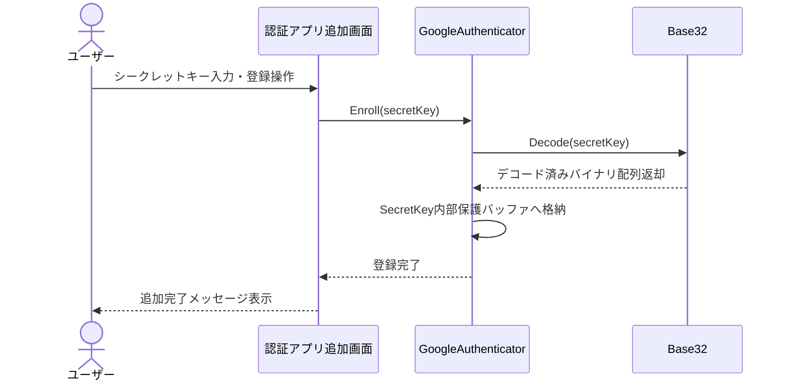
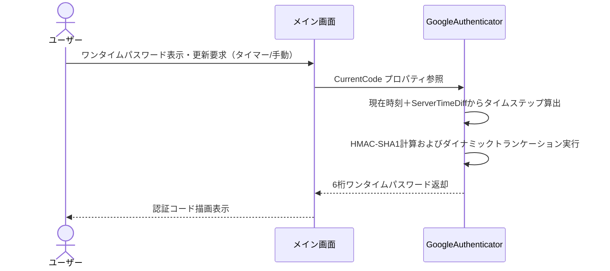
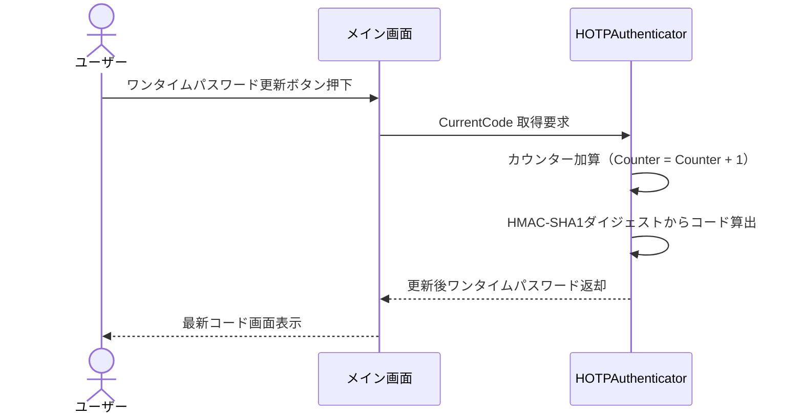
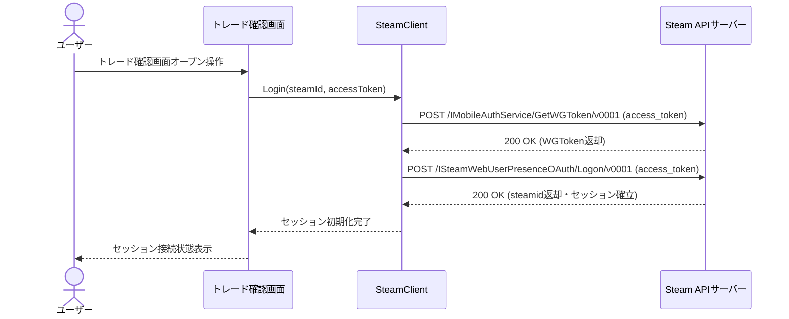
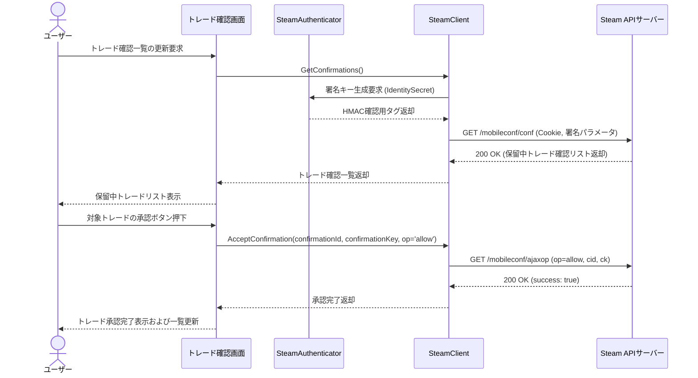
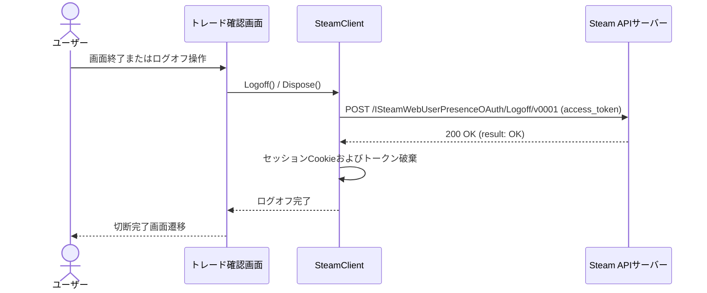

# シーケンス図

## 認証処理

認証アプリ追加画面にて入力されたBase32形式のシークレットキーをデコード検証し、GoogleAuthenticatorインスタンスへ格納するフロー。

**参加者:** ユーザー (actor)、認証アプリ追加画面 (system)、GoogleAuthenticator (system)、Base32 (system)

**メッセージフロー:**
- ユーザー → 認証アプリ追加画面: シークレットキー入力・登録操作
- 認証アプリ追加画面 → GoogleAuthenticator: Enroll(secretKey)
- GoogleAuthenticator → Base32: Decode(secretKey)
  - Base32 ← GoogleAuthenticator: デコード済みバイナリ配列返却
- GoogleAuthenticator → GoogleAuthenticator: SecretKey内部保護バッファへ格納
  - GoogleAuthenticator ← 認証アプリ追加画面: 登録完了
  - 認証アプリ追加画面 ← ユーザー: 追加完了メッセージ表示

## 認証処理

タイマー周期または手動要求をトリガーに、補正時刻とシークレットキーからHMAC-SHA1計算を行い、6桁の時間型ワンタイムパスワード（TOTP）を生成・表示するフロー。

**参加者:** ユーザー (actor)、メイン画面 (system)、GoogleAuthenticator (system)

**メッセージフロー:**
- ユーザー → メイン画面: ワンタイムパスワード表示・更新要求（タイマー/手動）
- メイン画面 → GoogleAuthenticator: CurrentCode プロパティ参照
- GoogleAuthenticator → GoogleAuthenticator: 現在時刻＋ServerTimeDiffからタイムステップ算出
- GoogleAuthenticator → GoogleAuthenticator: HMAC-SHA1計算およびダイナミックトランケーション実行
  - GoogleAuthenticator ← メイン画面: 6桁ワンタイムパスワード返却
  - メイン画面 ← ユーザー: 認証コード描画表示

## 認証処理

ユーザーの更新操作を契機に、内部カウンターをインクリメントし、RFC 4226に準拠したイベント駆動型ワンタイムパスワードを生成・更新するフロー。

**参加者:** ユーザー (actor)、メイン画面 (system)、HOTPAuthenticator (system)

**メッセージフロー:**
- ユーザー → メイン画面: ワンタイムパスワード更新ボタン押下
- メイン画面 → HOTPAuthenticator: CurrentCode 取得要求
- HOTPAuthenticator → HOTPAuthenticator: カウンター加算（Counter = Counter + 1）
- HOTPAuthenticator → HOTPAuthenticator: HMAC-SHA1ダイジェストからコード算出
  - HOTPAuthenticator ← メイン画面: 更新後ワンタイムパスワード返却
  - メイン画面 ← ユーザー: 最新コード画面表示

## 外部認証連携

SteamGuardのOAuthアクセストークンを用いてGetWGTokenおよびLogon APIを実行し、Steam Webセッションを確立するフロー。

**参加者:** ユーザー (actor)、トレード確認画面 (system)、SteamClient (system)、Steam APIサーバー (system)

**メッセージフロー:**
- ユーザー → トレード確認画面: トレード確認画面オープン操作
- トレード確認画面 → SteamClient: Login(steamId, accessToken)
- SteamClient → Steam APIサーバー: POST /IMobileAuthService/GetWGToken/v0001 (access_token)
  - Steam APIサーバー ← SteamClient: 200 OK (WGToken返却)
- SteamClient → Steam APIサーバー: POST /ISteamWebUserPresenceOAuth/Logon/v0001 (access_token)
  - Steam APIサーバー ← SteamClient: 200 OK (steamid返却・セッション確立)
  - SteamClient ← トレード確認画面: セッション初期化完了
  - トレード確認画面 ← ユーザー: セッション接続状態表示

## 外部認証連携

IdentitySecretを用いたHMAC署名付きリクエストで保留中トレード一覧を照会し、ユーザー操作に基づいて対象のトレードを承認するフロー。

**参加者:** ユーザー (actor)、トレード確認画面 (system)、SteamAuthenticator (system)、SteamClient (system)、Steam APIサーバー (system)

**メッセージフロー:**
- ユーザー → トレード確認画面: トレード確認一覧の更新要求
- トレード確認画面 → SteamClient: GetConfirmations()
- SteamClient → SteamAuthenticator: 署名キー生成要求 (IdentitySecret)
  - SteamAuthenticator ← SteamClient: HMAC確認用タグ返却
- SteamClient → Steam APIサーバー: GET /mobileconf/conf (Cookie, 署名パラメータ)
  - Steam APIサーバー ← SteamClient: 200 OK (保留中トレード確認リスト返却)
  - SteamClient ← トレード確認画面: トレード確認一覧返却
  - トレード確認画面 ← ユーザー: 保留中トレードリスト表示
- ユーザー → トレード確認画面: 対象トレードの承認ボタン押下
- トレード確認画面 → SteamClient: AcceptConfirmation(confirmationId, confirmationKey, op='allow')
- SteamClient → Steam APIサーバー: GET /mobileconf/ajaxop (op=allow, cid, ck)
  - Steam APIサーバー ← SteamClient: 200 OK (success: true)
  - SteamClient ← トレード確認画面: 承認完了返却
  - トレード確認画面 ← ユーザー: トレード承認完了表示および一覧更新

## 外部認証連携

セッション終了またはクライアント破棄時にSteam Webプレゼンスサービスからログオフし、セッションを安全に切断するフロー。

**参加者:** ユーザー (actor)、トレード確認画面 (system)、SteamClient (system)、Steam APIサーバー (system)

**メッセージフロー:**
- ユーザー → トレード確認画面: 画面終了またはログオフ操作
- トレード確認画面 → SteamClient: Logoff() / Dispose()
- SteamClient → Steam APIサーバー: POST /ISteamWebUserPresenceOAuth/Logoff/v0001 (access_token)
  - Steam APIサーバー ← SteamClient: 200 OK (result: OK)
- SteamClient → SteamClient: セッションCookieおよびトークン破棄
  - SteamClient ← トレード確認画面: ログオフ完了
  - トレード確認画面 ← ユーザー: 切断完了画面遷移

