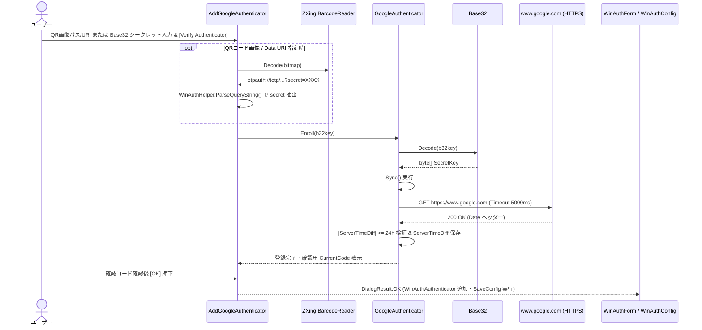
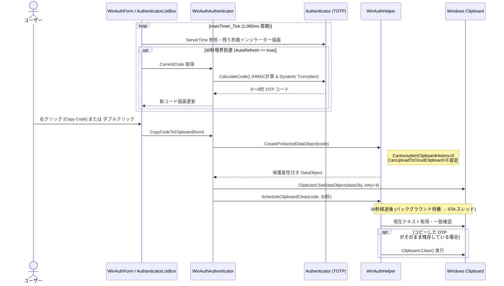
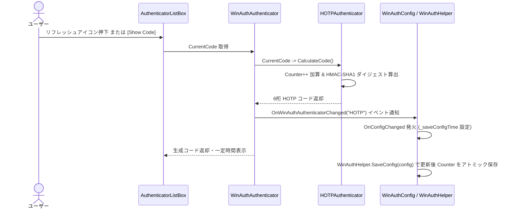
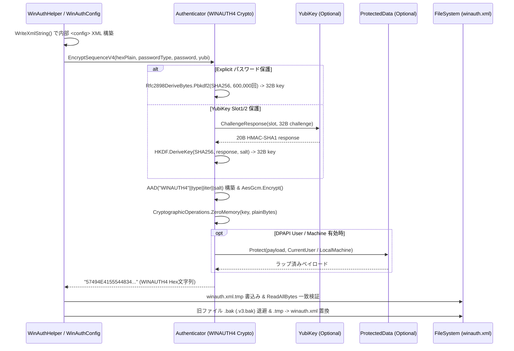
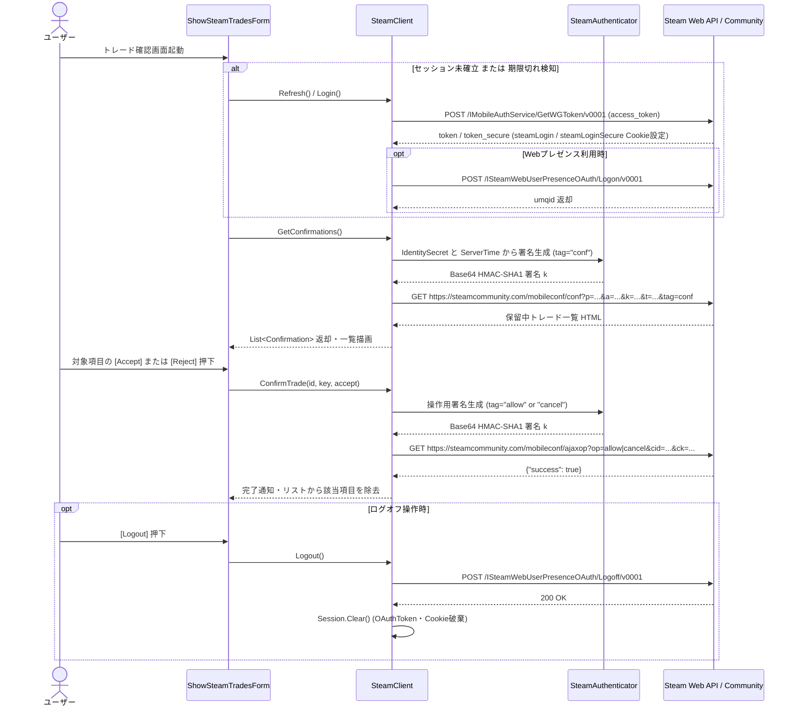
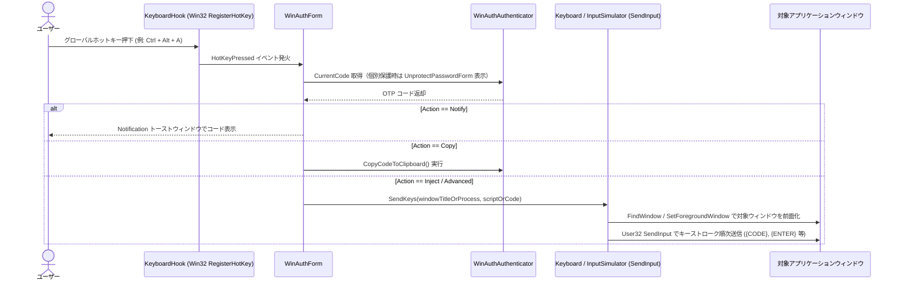

# シーケンス図

WinAuth の主要処理におけるクラス・メソッドレベルの相互作用をシーケンス図として定義します。

## 1. TOTP / QRコード認証器の新規登録と時刻同期（BP-001, BP-005, BP-008）

追加ダイアログ（`AddGoogleAuthenticator` / `AddOktaVerifyAuthenticator` 等）において、QRコードまたは Base32 シークレットキーを解析し、時刻同期を行って `WinAuthConfig` へ登録するシーケンスです。

---

## 2. TOTP 周期更新・クリップボード保護コピー・30秒自動消去（BP-001, BP-010）

1秒周期の `mainTimer` による TOTP 再計算と、コピー操作時の履歴除外属性付与および30秒後の自動クリア処理のシーケンスです。

---

## 3. HOTP 手動カウンター加算と遅延保存（BP-002, BP-009）

カウンター型（RFC 4226）認証器において、表示操作のたびにカウンターを加算して構成ファイルを更新するシーケンスです。

---

## 4. WINAUTH4 認証付き暗号化・復号とアトミック保存（BP-006, BP-007, BP-009）

`EncryptSequenceV4` / `DecryptSequenceV4` と `WinAuthHelper.SaveConfig` による改ざん耐性・耐クラッシュ永続化シーケンスです。

---

## 5. Steam Web セッション確立・トレード確認照会・承認・ログオフ（BP-004）

`ShowSteamTradesForm` と `SteamClient` が連携し、セッション確立・HMAC署名付き一覧取得・承認/拒否・ログオフを行うシーケンスです。

---

## 6. グローバルホットキー検知と Auto-Type 自動キー入力（BP-010）

バックグラウンド常駐中にグローバルホットキーを検知し、指定ウィンドウへワンタイムパスワードを自動送信するシーケンスです。

