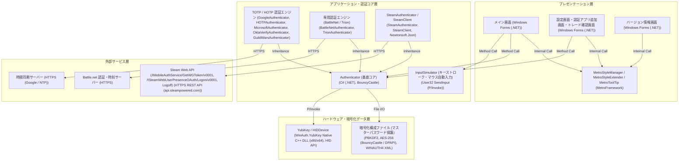

# アーキテクチャ構成図

WinAuthはWindows上で動作する各種二要素認証（2FA）・ワンタイムパスワード生成デスクトップアプリケーションです。Steam、Battle.net、Google等の認証プロトコル対応に加え、YubiKeyハードウェアトークンやキーストローク自動入力（InputSimulator）、MetroFrameworkによるモダンUIを備えています。

**プレゼンテーション層:**
- メイン画面 [Windows Forms (.NET)]
- 設定画面・認証アプリ追加画面・トレード確認画面 [Windows Forms (.NET)]
- バージョン情報画面 [Windows Forms (.NET)]
- MetroStyleManager / MetroStyleExtender / MetroToolTip [MetroFramework]

**アプリケーション・認証コア層:**
- Authenticator (基底コア) [C# (.NET), BouncyCastle]
- TOTP / HOTP 認証エンジン [GoogleAuthenticator, HOTPAuthenticator, MicrosoftAuthenticator, OktaVerifyAuthenticator, GuildWarsAuthenticator]
- 専用認証エンジン (BattleNet / Trion) [BattleNetAuthenticator, TrionAuthenticator]
- SteamAuthenticator / SteamClient [SteamAuthenticator, SteamClient, Newtonsoft.Json]
- InputSimulator (キーストローク・マウス自動入力) [User32 SendInput (P/Invoke)]

**ハードウェア・暗号化データ層:**
- YubiKey / HIDDevice [WinAuth.YubiKey Native C++ DLL (x86/x64), HID API]
- 暗号化構成ファイル (マスターパスワード保護) [PBKDF2, AES-256 (BouncyCastle / DPAPI), WINAUTH4 XML]

**外部サービス層:**
- Steam Web API (/IMobileAuthService/GetWGToken/v0001, /ISteamWebUserPresenceOAuth/Logon/v0001, Logoff) [HTTPS REST API (api.steampowered.com)]
- Battle.net 認証・時刻サーバー [HTTPS]
- 時間同期サーバー [HTTPS (Google / NTP)]

**接続:**
- メイン画面 → MetroStyleManager / MetroStyleExtender / MetroToolTip (Internal Call)
- 設定画面・認証アプリ追加画面・トレード確認画面 → MetroStyleManager / MetroStyleExtender / MetroToolTip (Internal Call)
- バージョン情報画面 → MetroStyleManager / MetroStyleExtender / MetroToolTip (Internal Call)
- メイン画面 → Authenticator (基底コア) (Method Call)
- 設定画面・認証アプリ追加画面・トレード確認画面 → Authenticator (基底コア) (Method Call)
- TOTP / HOTP 認証エンジン → Authenticator (基底コア) (Inheritance)
- 専用認証エンジン (BattleNet / Trion) → Authenticator (基底コア) (Inheritance)
- SteamAuthenticator / SteamClient → Authenticator (基底コア) (Inheritance)
- メイン画面 → InputSimulator (キーストローク・マウス自動入力) (Method Call)
- Authenticator (基底コア) → 暗号化構成ファイル (マスターパスワード保護) (File I/O)
- Authenticator (基底コア) → YubiKey / HIDDevice (P/Invoke)
- SteamAuthenticator / SteamClient → Steam Web API (/IMobileAuthService/GetWGToken/v0001, /ISteamWebUserPresenceOAuth/Logon/v0001, Logoff) (HTTPS)
- 専用認証エンジン (BattleNet / Trion) → Battle.net 認証・時刻サーバー (HTTPS)
- TOTP / HOTP 認証エンジン → 時間同期サーバー (HTTPS)

