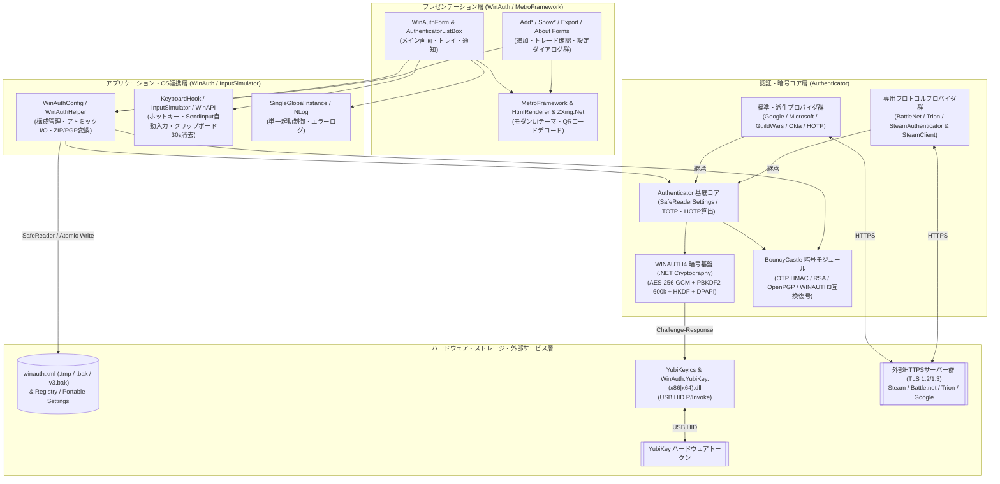
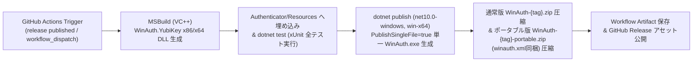

# アーキテクチャ構成図

WinAuth のソフトウェアレイヤ構造、プロジェクト間の依存関係、外部サービス・ハードウェア連携、および CI/CD ビルドパイプライン構成を以下に定義します。

## 1. レイヤ別コンポーネント構成

### プレゼンテーション層（`WinAuth.csproj` / `MetroFramework.csproj`）
- **メイン・管理フォーム群**: `WinAuthForm`, `AuthenticatorListBox`（`ClearTypeGridFit` オーナードロー描画）, `ChangePasswordForm`, `SetShortcutKeyForm`, `ExportForm`, `AboutForm`, `UpdateCheckForm`, `DiagnosticForm`, `ExceptionForm`, `Notification`
- **プロバイダ追加・閲覧フォーム群**: `AddAuthenticator`, `AddGoogleAuthenticator`, `AddMicrosoftAuthenticator`, `AddGuildWarsAuthenticator`, `AddOktaVerifyAuthenticator`, `AddBattleNetAuthenticator`, `AddSteamAuthenticator`, `AddTrionAuthenticator`, `ShowSteamTradesForm`, `ShowSecretKeyForm` 等
- **UI基盤・多言語/フォント・QR読取**: 同梱 `MetroFramework` / `MetroFramework.Fonts`（リサイズ追従・`Yu Gothic UI` 解決改修済）、`LanguageManager` / `CustomResourceManager`（埋め込み＋外部 `Language/*.json` 連携）、`UiFontHelper`（`Yu Gothic UI` / `Consolas` 適用）、`HtmlRenderer.WinForms`、`ZXing.Net`（QRコード解析）

### アプリケーション・OS連携層（`WinAuth.csproj` / `InputSimulator.csproj`）
- **構成・永続化管理**: `WinAuthMain`, `WinAuthConfig`, `WinAuthAuthenticator`, `WinAuthHelper`（アトミックファイル保存・レジストリ/ポータブル切替・ZIP/OpenPGP入出力）、`WinAuthUpdater`
- **OS統合制御**: `SingleGlobalInstance`（Mutex排他）、`KeyboardHook` / `HotKey`、`Keyboard` / `InputSimulator`（`User32 SendInput` 自動入力）、`WinAPI`（クリップボード保護・USB着脱 `WM_DEVICECHANGE`）

### 認証・暗号コア層（`Authenticator.csproj`）
- **認証アルゴリズム・プロバイダ**: `Authenticator`（抽象基底・RFC 6238/4226・`SafeReaderSettings`）、`GoogleAuthenticator`（派生: `Microsoft`, `GuildWars`, `OktaVerify`）、`HOTPAuthenticator`、`BattleNetAuthenticator`、`TrionAuthenticator`、`SteamAuthenticator` / `SteamClient`、`Base32`
- **暗号化基盤**:
  - **現行 `WINAUTH4`**: `.NET System.Security.Cryptography`（`AesGcm` AEAD、`Rfc2898DeriveBytes.Pbkdf2` 600,000反復、`HKDF`、`ProtectedData` DPAPI、`CryptographicOperations.ZeroMemory`）
  - **プロトコル・互換**: `BouncyCastle.Cryptography`（OTP用 HMAC、Battle.net RSA、OpenPGP、旧 `WINAUTH3` 互換復号）

### ハードウェア・外部通信層（`WinAuth.YubiKey` / HTTPS）
- **ハードウェア連携**: `YubiKey` / `HIDDevice` ↔ 埋め込みリソース `WinAuth.YubiKey.x86.dll` / `WinAuth.YubiKey.x64.dll`（C/VC++ ネイティブ DLL、USB HID 通信）
- **外部 HTTPS サービス**: Steam Web API / Steam Community、Battle.net Mobile Service、Trion Worlds API、Google（HTTPS `Date` 時刻同期）

---

## 2. システムアーキテクチャ構成図（Mermaid）

---

## 3. CI/CD ビルド・パッケージング構成（`.github/workflows/release.yml`）

