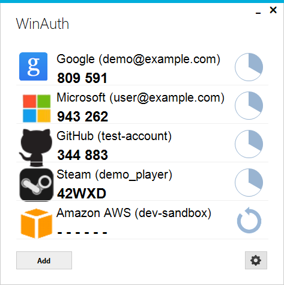

# Windows Authenticator (WinAuth)

*WinAuth は、RFC 6238（時刻ベース TOTP）および RFC 4226（カウンターベース HOTP）に準拠した、Windows 向けのポータブルなオープンソース二要素認証（2FA）クライアントです。Google Authenticator 互換の各種 Web サービスや暗号資産取引所のほか、Steam、Battle.net、Guild Wars 2、Glyph（Rift / ArcheAge）など多様なサービスに対応しています。*

本リポジトリは、Colin Mackie 氏によるオリジナルの WinAuth をベースに、CTD Networks Co., Ltd. にて **.NET 10 への移行**、**暗号基盤の刷新（WINAUTH4）**、および **セキュリティ脆弱性の改修** を行ったバージョン（v4.0 以降）です。



*※ 画面内のアカウントおよびワンタイムパスワードはすべてテスト用のダミーデータです。*

---

## 主な機能・特徴

* **標準規格および主要サービスへの対応**
  * 時刻ベースの RFC 6238（TOTP：Google Authenticator、Microsoft Authenticator、Okta Verify 等）およびカウンターベースの RFC 4226（HOTP）に対応
  * Steam（Steam Guard およびトレード確認機能）、Battle.net、Guild Wars 2、Trion / Glyph などの各種ゲーム・Web サービスに対応
* **効率的な操作性**
  * 複数の認証器（ワンタイムパスワード）を一覧表示し、自動更新またはオンデマンドでコードを表示
  * システムトレイ常駐、ホットキー割り当てによるコード通知・自動キーボード入力・クリップボードコピーに対応
  * 標準アイコンの選択やカスタムアイコンの設定が可能
  * `otpauth://` URI 形式等でのインポート・エクスポートに対応
* **ポータブル運用に対応**
  * インストーラー不要で単一の `WinAuth.exe` から実行可能
  * 実行ファイルと同じフォルダに設定ファイルを配置することで、レジストリや他フォルダを変更しないポータブルモードで動作
* **強化されたセキュリティと後方互換性**
  * **WINAUTH4 暗号基盤**: PBKDF2（600,000 反復）による鍵導出と **AES-256-GCM**（認証付き暗号）により、秘密鍵データの機密性と完全性（改ざん検知）を保護
  * ユーザー設定のパスワード保護に加え、Windows アカウント／マシンへの紐付け（DPAPI）、YubiKey によるハードウェア保護、認証器単位での個別パスワード設定に対応
  * **後方互換性**: 従来の WinAuth 3 系（WINAUTH3 形式）で作成された設定ファイル（`winauth.xml`）もそのまま読み込み可能
  * XXE（XML 外部エンティティ）攻撃対策など各種セキュリティ強化を実施済み

---

## 動作環境

* **対応 OS**: Windows 10 / Windows 11（x64）
* **必須ランタイム**: [.NET 10 Desktop Runtime](https://dotnet.microsoft.com/download/dotnet/10.0)（Windows デスクトップ ランタイム 10.0）

---

## ダウンロードと使い方

### ダウンロード
最新版のバイナリは本リポジトリの [Releases](https://github.com/CTD-Networks-CO-LTD/winauth/releases) ページからダウンロードできます（`WinAuth-<バージョン>.zip` および検証用の `.sha256` チェックサムファイルが提供されます）。

### 基本的な使い方
1. 事前に .NET 10 Desktop Runtime がインストールされていることを確認します。
2. ダウンロードした ZIP ファイルを展開し、`WinAuth.exe` を任意のフォルダに配置して起動します（インストール作業は不要です）。
3. **［Add］** ボタンをクリックし、認証器の追加またはインポートを行います。
4. 登録した認証器を右クリックすると、コードのコピーや詳細設定などのコンテキストメニューが表示されます。
5. 自動更新を無効にしている場合は、右側のアイコンをクリックすると現在のコードが表示されます。
6. 歯車（オプション）アイコンからアプリケーション全体の設定を行えます。

---

## ソースコードからのビルド

ソースコードからビルドおよび単体テストを実行するには、**.NET 10 SDK** が必要です。

```powershell
dotnet restore WinAuth.sln
dotnet build WinAuth.sln -c Release
dotnet test WinAuth.sln -c Release
```

YubiKey ネイティブ DLL のビルド方法や単一実行ファイル（`PublishSingleFile`）の発行手順など、詳細は [COMPILING.md](COMPILING.md) を参照してください。

---

## よくある質問（FAQ）

#### 安全ですか？
二要素認証はセキュリティの層を追加するものであり、単体で 100% の安全を保証するものではありません。物理的に独立したハードウェアトークン等と比較すると PC 上で動作するソフトウェアには固有のリスクがありますが、WinAuth では秘密鍵データを暗号化されたファイル（AES-256-GCM / DPAPI 等）として保護し、PC 上で可能な限り安全に管理できるよう設計されています。マスターパスワードの設定および設定ファイルの適切な管理を強く推奨します。

#### ウイルス・マルウェア・キーロガーなどの心配はありませんか？
WinAuth はオープンソースソフトウェアとして公開されており、誰でもソースコードを検証し、自身でビルドすることができます。
外部のサードパーティサーバーへ個人情報やアカウント情報を送信することはなく、他の実行ファイルを勝手にインストールすることもありません。

#### 認証器のデータはどこに保存されますか？
クラウドや外部サーバーには一切保存されません。デフォルトでは Windows のローミングプロファイル配下（`%AppData%\WinAuth\winauth.xml`、例: `C:\Users\<ユーザー名>\AppData\Roaming\WinAuth\winauth.xml`）に保存されます。
また、`winauth.xml` を `WinAuth.exe` と同じフォルダに配置する（ポータブルモード）か、起動時のコマンドライン引数で任意のファイルパスを指定して使用することも可能です。PC の故障や紛失に備え、定期的にバックアップを取得してください。

---

## 商標について

本文中に記載されている製品名・サービス名（Blizzard、Battle.net、World of Warcraft、Diablo、ArenaNet、Guild Wars 2、Trion、Rift、Google、Microsoft、Okta、Steam 等）は、各社の商標または登録商標です。

---

## 著作権・クレジット

* オリジナル開発者: Colin Mackie（Copyright © 2010-2017 Colin Mackie）
* .NET 10 移行・セキュリティ改修: CTD Networks Co., Ltd.（Copyright © 2013-2026 Colin Mackie / Modified 2026 CTD Networks Co., Ltd.）

---

## ライセンス

本プログラムはフリーソフトウェアです。Free Software Foundation が公表した **GNU General Public License（バージョン 3、またはそれ以降のバージョン）** の条件の下で再頒布および改変することができます。

本プログラムは有用であることを願って頒布されますが、商品性や特定目的への適合性の暗黙の保証を含め、**いかなる保証もありません**。詳細は [LICENSE](LICENSE) または <https://www.gnu.org/licenses/> を参照してください。
